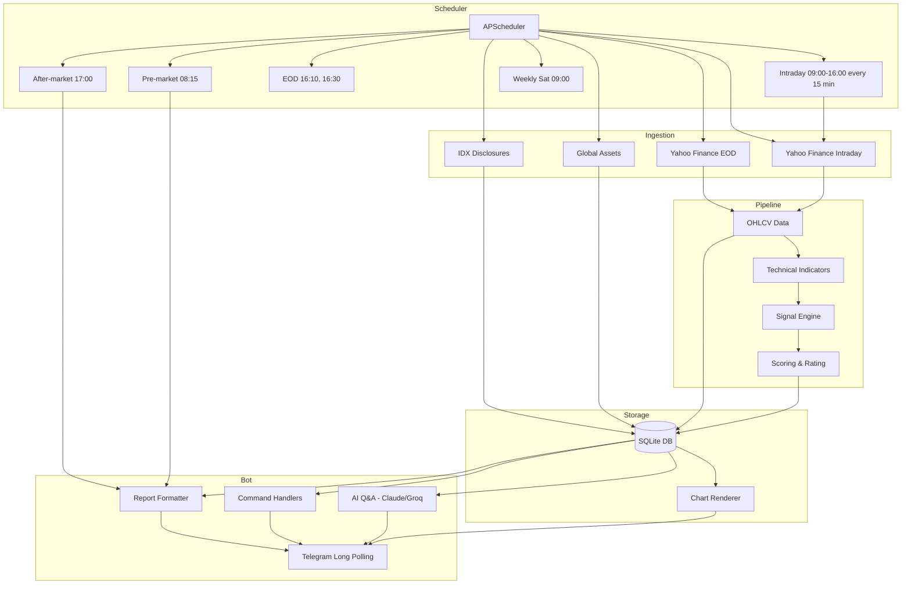

# Sahamku

[](https://github.com/muhfalihr/sahamku/actions/workflows/ci.yml)

**Automated Telegram bot for Indonesian stock market (IDX) technical analysis and trading signals.**

Sahamku scans liquid IDX/LQ45 stocks daily and delivers automated pre-market and after-market reports with rule-based technical signals, performance charts, watchlists, and AI-powered Q&A. Built for traders who want systematic technical analysis delivered directly to Telegram, running 24/7 on Docker.

**Disclaimer:** This bot is for informational and educational purposes only. All signals are analytical outputs based on historical data and technical indicators. Not financial advice. Trading decisions and their outcomes are solely your responsibility.

---

## Features

- **Automated Daily Reports**
  - Pre-market analysis (global sentiment, IHSG support/resistance, previous signals, watchlists)
  - Midday summary during trading hours
  - After-market report (IHSG recap, top movers, bullish/bearish signals, watchlists)
  - Weekly performance recap

- **Technical Signals**
  - Rule-based scoring: Golden/Death Cross (SMA50/200), RSI oversold/overbought, breakout/breakdown with volume, MACD cross, Bollinger Squeeze
  - Multi-factor rating system (bullish ≥ +2, bearish ≤ −2)
  - Backtested on LQ45 stocks (3-year historical data)

- **Interactive Commands**
  - `/scan` — After-market report from latest data
  - `/stock BBCA` — Snapshot: price, indicators, rating, signals + 60-day chart
  - `/growth` — Top 20 Potential Growth candidates (technical scoring)
  - `/watch` / `/unwatch` / `/watchlist` — Per-chat watchlist management
  - `/ask <question>` — AI-powered Q&A with market context (Claude/Groq), remembers conversation for 2 hours
  - `/ihsg` — Index snapshot + chart + support/resistance
  - `/news [TICKER]` — Market/stock news with sentiment (🟢🔴⚪)
  - `/screener rsi<35 above200` — Filter stocks by rating, RSI, volume, breakout, etc.
  - `/compare BBCA BBRI BMRI` — Multi-stock return comparison with normalized chart
  - `/sector` — Sector averages, bullish/bearish counts, best/worst performers
  - `/alert BBCA > 6500` — Price/RSI alerts (checked every 15 minutes during trading hours + after close)

- **Architecture Highlights**
  - Scheduled jobs with APScheduler (market hours, pre/post-market timing)
  - EOD + intraday data ingestion from Yahoo Finance
  - IDX disclosure integration (material contracts, dividends, corporate actions)
  - SQLite storage for OHLCV, indicators, signals, user preferences
  - Chart rendering with mplfinance
  - Telegram long polling (aiogram 3.x)
  - Claude/Groq LLM integration for conversational Q&A
  - Dockerized deployment with auto-restart

---

## Architecture



---

## Tech Stack

- **Language:** Python 3.12
- **Bot Framework:** aiogram 3.13+ (Telegram Bot API)
- **Scheduler:** APScheduler 3.10
- **Data:** Yahoo Finance (yfinance), pandas, numpy
- **Database:** SQLite (OHLCV, indicators, signals, user state)
- **Charts:** mplfinance
- **AI/LLM:** Anthropic Claude / Groq
- **Testing:** pytest, ruff
- **Deployment:** Docker + Docker Compose

---

## Configuration

All configuration is managed through environment variables. Copy `.env.example` to `.env` and fill in required values:

```bash
# Required
TELEGRAM_BOT_TOKEN=<your_bot_token>
ADMIN_CHAT_ID=<your_telegram_chat_id>

# LLM provider (groq or anthropic)
LLM_PROVIDER=groq
GROQ_API_KEY=<your_groq_api_key>
ANTHROPIC_API_KEY=<your_anthropic_api_key>

# Optional
CHANNEL_ID=@your_channel  # For broadcasting reports (bot must be channel admin)
UNIVERSE=liquid           # Stock universe: lq45 | idx80 | liquid
DB_PATH=sahamku.db
SCHEDULE_OVERRIDE_AFTERMARKET=17:00  # Override schedule for testing
```

**Finding your Telegram chat ID:** Send `/start` to your bot and check the logs, or use [@userinfobot](https://t.me/userinfobot).

---

## Setup & Development

### Linux / macOS

```bash
# Clone repository
git clone https://github.com/muhfalihr/sahamku.git
cd sahamku

# Create virtual environment
python3.12 -m venv .venv
source .venv/bin/activate

# Install dependencies
pip install -e ".[dev]"

# Configure environment
cp .env.example .env
# Edit .env with your tokens and API keys

# Backfill historical data (3 years + compute indicators/signals, ~1 minute)
python scripts/backfill.py

# Run bot (long polling + scheduler)
python -m sahamku.bot.main
```

### Windows

```bash
# Clone repository
git clone https://github.com/muhfalihr/sahamku.git
cd sahamku

# Create virtual environment
python -m venv .venv
.venv\Scripts\activate

# Install dependencies
pip install -e ".[dev]"

# Configure environment
copy .env.example .env
# Edit .env with your tokens and API keys

# Backfill historical data
python scripts/backfill.py

# Run bot
python -m sahamku.bot.main
```

**Note:** Do not run local long polling simultaneously with Docker — Telegram allows only one active long-polling session per bot.

---

## Docker Deployment

### Local Docker (24/7 on your machine)

```bash
# Build and start in background with auto-restart
docker compose up -d --build

# View logs
docker compose logs -f

# Stop
docker compose down
```

- Database and charts are persisted in `./data/` volume
- If `data/sahamku.db` does not exist, the entrypoint runs backfill automatically on first start
- After changing `.env`: `docker compose up -d` (recreate container)
- After code changes: `docker compose up -d --build`
- For 24/7 operation: Enable **Docker Desktop → Settings → General → Start Docker Desktop when you sign in**

### VPS Deployment (Ubuntu 22.04/24.04)

For initial VPS setup, follow the [VPS runbook](docs/VPS.md). After SSH alias `bot-vps` is configured and `/opt/sahamku/.env` is populated:

```bash
bash scripts/deploy.sh
```

The script creates a Git archive of the current commit, transfers it to `/opt/sahamku` on the VPS, rebuilds the Docker image, and replaces the running container. No GitHub access required on VPS.

**Verify deployment:**
```bash
ssh bot-vps "cd /opt/sahamku && sudo docker compose ps"
```

---

## Testing

Run the full test suite:

```bash
pytest
```

Run with verbose output:

```bash
pytest -v
```

Lint code:

```bash
ruff check sahamku tests
```

Manual job testing (no Telegram messages sent):

```bash
python scripts/run_job.py aftermarket  # Print after-market report
python scripts/run_job.py premarket    # Print pre-market report
python scripts/run_job.py chart BBCA   # Generate chart
```

---

## Scheduled Jobs

Jobs run in Asia/Jakarta timezone (WIB) on trading days. Market holidays are defined in `sahamku/universe.py`.

| Time | Job |
|------|-----|
| 07:30, 07:45 | Ingest global assets (Wall Street, Asia, oil, gold, USD/IDR, UST10Y) + news |
| 08:15 | Send pre-market report (global sentiment, IHSG support/resistance, previous signals, watchlist) |
| 09:00–16:00 every 15 min | Intraday snapshot (delayed) + check alerts |
| 12:15 (Fri 11:45) | Midday summary |
| 16:10, 16:30 | Ingest EOD + validate → compute indicators, signals, Potential Growth. Retry every 15 min until 18:00 if incomplete |
| 17:00 | Send after-market report (IHSG, top movers, bullish/bearish signals, squeeze, watchlist) |
| Sat 09:00, 09:15 | Weekly recap (users + channel) + backtest to admin |

**Testing schedule overrides:** Set `SCHEDULE_OVERRIDE_AFTERMARKET=HH:MM` or `SCHEDULE_OVERRIDE_PREMARKET=HH:MM` in `.env`. EOD ingestion runs automatically 2 minutes before the report send time.

---

## Stock Universe Management

The bot supports three universe modes:

- `lq45` — LQ45 index constituents
- `idx80` — IDX80 index constituents
- `liquid` — Custom liquid stocks from CSV master file (recommended)

### Importing IDX Stock Master

```bash
# Validate CSV before import
python scripts/update_universe.py idx-stocks.csv

# Apply after validation passes
python scripts/update_universe.py idx-stocks.csv --apply
```

CSV format (UTF-8): `code,name,sector,board,instrument_type,status`

### KSEI Master File Normalization

If using KSEI **Master File Efek**, normalize first (filters for active IDX equity with 4-letter codes):

```bash
python scripts/normalize_ksei_master.py data/source/StatisEfek20260831.txt.zip \
  --output data/source/idx-stocks-2026-08-31.csv

python scripts/update_universe.py data/source/idx-stocks-2026-08-31.csv --apply \
  --source-date 2026-08-31
```

**Note:** KSEI master does not include IDX board listings. The normalized CSV sets `board=Unknown` explicitly. After import, restart the bot to backfill new tickers. If no master is available, `liquid` mode falls back to IDX80.

---

## User Tiers

| Feature | Free | Pro (Admin-granted) |
|---------|------|---------------------|
| Watchlist | 5 stocks | 30 stocks |
| Active alerts | 3 | 20 |
| `/ask` per day | 10 | 50 |

Pro tier is manually granted by admin via `/admin pro <chat_id>`. Payment integration not yet implemented.

---

## Signal Rules & Backtesting

Rules defined in `sahamku/signals/rules.py`, weights in `scoring.py`, thresholds in `config.py`:

- Golden/Death Cross (SMA50/200)
- RSI oversold/overbought cross
- Breakout/breakdown 20D high/low + volume ≥ 1.5× average
- MACD cross
- Bollinger Squeeze (informational)
- Position relative to SMA200

**Scoring:** Score ≥ +2 → bullish, ≤ −2 → bearish.

### Backtest Results (LQ45, 3 years to 2026-09-11, no transaction costs)

| Rule | Direction | n | Win 10D | Avg 10D |
|------|-----------|---|---------|---------|
| RSI overbought | Bear | 366 | 58.7% | +1.25% |
| Death cross | Bear | 90 | 53.3% | +1.16% |
| RSI oversold | Bull | 465 | 53.3% | +1.41% |
| MACD cross down | Bear | 1334 | 50.5% | +0.09% |
| Breakdown 20D + vol | Bear | 738 | 44.7% | −0.69% |
| Breakout 20D + vol | Bull | 772 | 42.6% | −0.31% |
| MACD cross up | Bull | 1330 | 41.2% | −0.65% |
| Golden cross | Bull | 77 | 37.7% | −1.40% |

Returns calculated in signal direction. During this period, IHSG trended down, favoring mean-reversion (RSI) over momentum. Use these results to tune weights/thresholds.

Run backtest:

```bash
python -m sahamku.backtest.run
```

---

## Project Structure

```
sahamku/
  config.py        # Environment vars & thresholds
  db.py            # SQLite schema & queries
  universe.py      # IDX universe, global assets, market holidays
  pipeline.py      # OHLCV → indicators → signals → rating
  ingestion/
    eod.py         # EOD data ingestion
    global_.py     # Global assets
    intraday.py    # Intraday snapshots
  indicators/
    technical.py   # SMA, RSI, MACD, Bollinger Bands
  signals/
    rules.py       # Signal rules
    scoring.py     # Multi-factor scoring
  analysis/
    premarket.py   # Pre-market report generation
    aftermarket.py # After-market report generation
    growth.py      # Potential Growth ranking
  report/
    format.py      # Telegram HTML formatting
    chart.py       # Chart rendering with mplfinance
  llm/
    ask.py         # Claude/Groq Q&A
    providers.py   # LLM provider abstraction
  bot/
    main.py        # Bot entry point
    handlers.py    # Telegram command handlers
    scheduler.py   # APScheduler job definitions
  backtest/
    run.py         # Backtest runner
scripts/
  backfill.py      # Historical data backfill
  run_job.py       # Manual job execution
  update_universe.py # Stock universe management
tests/
```

---

## Data Sources & Limitations

- **Market data:** Yahoo Finance (free, EOD). Possible delays/gaps. `validate_eod` + retry mechanism handles this. Partial reports are flagged with missing tickers.
- **Intraday data:** 15-minute delayed snapshots during market hours
- **News:** IDX disclosures, RSS feeds with sentiment analysis
- **Global assets:** Wall Street indices, Asian markets, commodities, USD/IDR, US Treasury 10Y

**Database location:** `sahamku.db` (configurable via `DB_PATH`)  
**Charts location:** `charts/` directory (configurable via `CHARTS_DIR`)

**Important:** Never commit `.env`, `*.db`, or `charts/` to version control.

---

## Contributing

Contributions welcome! This is a personal project built for learning and practical use.

1. Fork the repository
2. Create a feature branch
3. Run tests: `pytest`
4. Lint: `ruff check sahamku tests`
5. Submit a pull request

---

## License

MIT License — see LICENSE file for details.

---

## Contact

**Developer:** Muhammad  
**Role:** Backend/Full-Stack Developer | AI Engineering  
**Looking for:** Remote full-stack and AI engineering roles

For questions or collaboration: [GitHub Issues](https://github.com/muhfalihr/sahamku/issues)

---

**Built with Python 3.12 • aiogram • pandas • SQLite • Docker • Claude AI**
